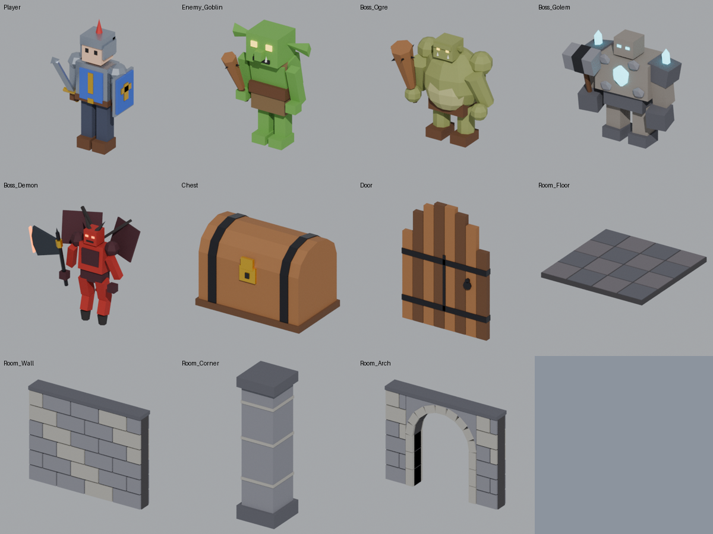

# Dungeon Depths

Dungeon crawler 3D de acción para PC, hecho en **Unity 6000.3.21f1 (URP)** con arquitectura **MVC**.
Proyecto de la asignatura Tecnologías Inmersivas.

El jugador recorre una mazmorra de **3 niveles**. Cada nivel tiene 3 salas en línea: **entrada → cofre → jefe**. Derrota al jefe del nivel 3 para ganar.



---

## Cómo abrir y jugar (primera vez)

1. Abre **Unity Hub → Add → Add project from disk** y elige la carpeta del repositorio. Usa Unity **6000.3.21f1**.
2. Si Unity pregunta si quieres activar el nuevo Input System (*enable the new input system backends*), responde **Yes**. El Editor se reinicia.
3. En el menú superior, ejecuta **Dungeon → Build Everything**. En un solo paso:
   * configura URP, si falta;
   * crea los datos de los 3 niveles en `Assets/Resources/Data`;
   * crea los prefabs en `Assets/Prefabs`;
   * crea las escenas `MenuPrincipal`, `Nivel1`, `Nivel2`, `Nivel3` y `GameOver` y las agrega a Build Settings.
4. Se abre la escena **MenuPrincipal**. Pulsa **Play**.

> Hagan el paso 3 **una sola vez**, en el PC de una sola persona. Esa persona hace commit de lo generado (`Assets/Resources/Data`, `Assets/Prefabs`, `Assets/Scenes`, `Assets/Settings`, `Assets/Materials`, `ProjectSettings`, `Packages/packages-lock.json` y todos los `.meta`). Los demás solo descargan.

### Controles
| Acción | Tecla |
|---|---|
| Mover | WASD o flechas |
| Apuntar | Mouse (el personaje mira hacia el cursor) |
| Atacar | Clic izquierdo o Espacio |
| Esquivar (te hace invulnerable un instante) | Shift |
| Abrir cofre | E |

### Cómo se juega
* **Sala 1 (Entrada):** derrota a los goblins y se abre la puerta.
* **Sala 2 (Tesoro):** abre el cofre con **E**. Da un arma, una mejora o una curación, y la puerta se abre.
* **Sala 3 (Jefe):** su barra de vida aparece arriba. Cuando el **círculo rojo** crece en el piso, aléjate o esquiva. Al 50 % de vida entra en **furia**: pega más fuerte y es más rápido. Al vencerlo se abre la puerta; crúzala para pasar al siguiente nivel.
* Conservas la vida y los ítems entre niveles. Si tu vida llega a 0, pierdes.

| Nivel | Enemigos por sala | Cofre | Jefe |
|---|---|---|---|
| 1 · Las Catacumbas | 2 / 0 / 0 | Espada de acero (daño +6) | Grok, el Ogro |
| 2 · Las Cavernas de Cristal | 3 / 1 / 0 | Amuleto de vida (vida máxima +40) | Gólem de Cristal |
| 3 · El Abismo Ardiente | 3 / 2 / 1 | Elixir del héroe (+100 de vida) | Malakor, el Demonio |

Para cambiar la dificultad, edita los assets de `Assets/Resources/Data` en el Inspector y vuelve a ejecutar **Dungeon → Rebuild Scenes Only**, que reparte los enemigos según `enemiesPerRoom`. La vida, el daño y la velocidad no necesitan reconstruir escenas.

---

## Arquitectura MVC

```
Assets/Scripts/
├── Model/       C# puro (sin UnityEngine; lo impone la asmdef). Reglas + eventos System.Action
├── Data/        ScriptableObjects con los números de cada nivel
├── View/        MonoBehaviours que SOLO muestran (HUD, barras, animaciones, sonido)
├── Controller/  MonoBehaviours que leen la entrada y coordinan
└── Editor/      Automatización: prefabs, escenas, datos, URP
```

Dependencias en un solo sentido: `Controller → View, Model, Data` · `View → Model` · `Data → Model` · `Model → nada`.

| Capa | Clases |
|---|---|
| **Modelo** | `Health`, `PlayerState`, `EnemyState`, `BossState`, `Item`, `ChestModel`, `LevelState`, `GameSession`, `Cooldown` |
| **Vista** | `HUDView`, `BossHealthBarView`, `EnemyHealthBarView`, `ChestView`, `DoorView`, `CharacterView`, `CameraFollowView`, `TelegraphView`, `MainMenuView`, `GameOverView`, `SfxPlayer` |
| **Controlador** | `PlayerController`, `EnemyController`, `BossController`, `ChestController`, `RoomController`, `RoomExitTrigger`, `GameController`, `MenuController` |
| **Datos** | `PlayerConfig`, `EnemyConfig`, `BossConfig`, `ItemData`, `LevelConfig` |

**Flujo de un golpe:** `PlayerController` lee el clic → `OverlapSphere` encuentra al enemigo (`IDamageable`) → `EnemyState.TakeDamage()` (Modelo) → evento `HealthChanged` / `Died` → `EnemyHealthBarView` y `CharacterView` lo muestran → `RoomController` avisa a `LevelState` → `DoorUnlocked` → `DoorView.Open()`.

---

## Pruebas
* **Pruebas del Modelo en Unity:** *Window → General → Test Runner → EditMode → Run All*. Son 48 pruebas.
* **Pruebas del Modelo sin Unity** (requiere .NET 8 SDK):

```
dotnet test Tools/ModelTests
```

* **Escena para revisar los modelos 3D:** *Dungeon → Build Model Showcase Scene*.

## Modelos 3D
Se generan con Blender a partir de los scripts de [`BlenderScripts/`](BlenderScripts/LEEME.md). Los `.blend` editables están en `BlenderModels/` y las vistas previas en `docs/previews/`.

## Fuera de alcance
Multijugador, guardado de partida, generación aleatoria de salas e inventario complejo.

## Metadatos
Después de crear scripts o carpetas fuera de Unity, corre `python3 Tools/generate_meta.py`. Así todo el equipo comparte los mismos GUID.
